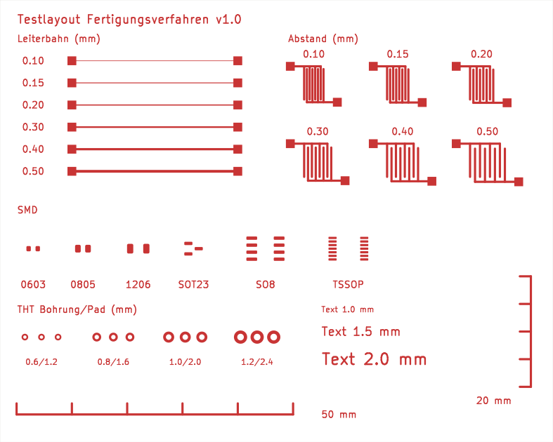

# Test layout for fabrication methods

🇩🇪 [Deutsch](README.de.md) · [← Overview](../../README.md)

Standardised test board (100 × 80 mm, single-sided F.Cu) for comparing fabrication methods under identical conditions:

1. Direct laser ablation (xTool F2 Ultra, fiber laser)
2. Laser mask + etching (laser removes paint, then ferric chloride)
3. CNC isolation milling
4. Classic etching (toner transfer or similar)

## Test structures

| Field | Content | Check |
|---|---|---|
| Track width | Tracks 0.10 / 0.15 / 0.20 / 0.30 / 0.40 / 0.50 mm, 30 mm long between two test pads | Continuity and resistance (multimeter), width under magnifier/microscope |
| Clearance | Comb structures with gaps 0.10 … 0.50 mm (track width 0.4 mm) | Isolation between pad A and pad B (multimeter: no continuity) |
| SMD | 0603, 0805, 1206, SOT-23, SOIC-8, TSSOP-14 (KiCad standard library) | Pads complete and separated? Test assembly |
| THT | Drill/pad 0.6/1.2 · 0.8/1.6 · 1.0/2.0 · 1.2/2.4 mm | Annular ring after drilling, alignment |
| Text | Copper text 1.0 / 1.5 / 2.0 mm | Legibility |
| Scale | 50 mm (X) and 20 mm (Y) with ticks | Dimensional accuracy with calipers |

The template's design rules are deliberately lowered for this project (min. 0.1 mm) so the test structures pass DRC. Normal projects keep the values from [design rules](../../docs/en/03-design-rules.md).

## Procedure and measurement sheet

See the German version [README.de.md](README.de.md) for the full procedure and the measurement sheet.

## Files

- `generate_testlayout.py` creates `testlayout.kicad_pcb` and `testlayout.kicad_pro` (values editable at the top of the script). Open in KiCad and run DRC afterwards.
- The KiBot workflow generates the laser files (DXF, SVG, Gerber) automatically in `laser/`.
